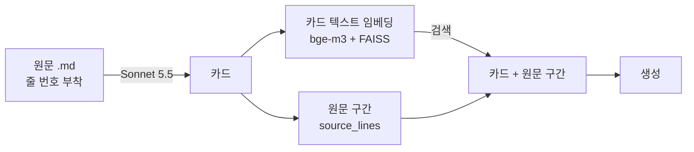
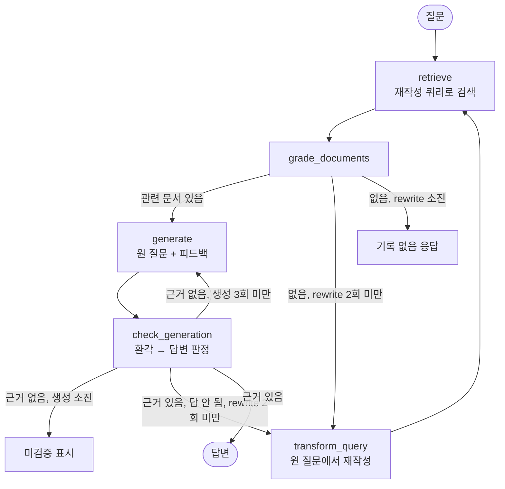

# troubleshooting-rag

막 적어둔 개인 트러블슈팅 기록을 대상으로 한 RAG 실험.
**Self-RAG(agentic)를 붙이면 단순 RAG(baseline)보다 나아지는가?** 이 질문을 골든셋으로 측정하고, 변경을 하나씩 분리해서 효과를 쟀다.

## 결론

1. 처음 보였던 "Self-RAG가 더 낫다/못하다"의 차이는 **루프가 아니라 생성 프롬프트 차이**였다. 프롬프트를 통일하자 두 시스템의 coverage가 같아졌다.
2. Self-RAG 루프의 버그를 차례로 고쳐도 coverage는 baseline과 같았다. 효과가 있었던 것은 **함정 질문(기록에 없는 내용)에서 지어내지 않는 것**뿐이었고, 비용은 질문당 호출 약 9배, 지연 약 3배였다.
3. 진짜 병목은 검색 단위였다. 기록이 정형화되어 있지 않아서 헤더 기준 청킹이 한 사례의 문제·원인·해결을 다른 청크로 흩어놓았다. **LLM으로 기록을 사례 카드로 정리**하자 두 시스템 모두 coverage가 약 +11%p 올랐다.

## 단계별 결과

30문항 × 2시스템 × 3회 반복. 각 단계는 직전 단계 코드에서 하나의 변경만 더했다.

| 단계 | 변경 | coverage (baseline / agentic) | negative 정답 (baseline / agentic) | agentic 호출·지연 / 질문 |
|---|---|---|---|---|
| 0 | 수정 전 | 85% / 80% | 93% / 93% | 9.8회 · 29.6초 |
| 1 | 생성 프롬프트 통일 | 81% / 81% | 93% / 73% | 9.8회 · 27.1초 |
| 2 | 검증 흐름 수정 | 80% / 75% | 87% / 100% | 9.3회 · 32.6초 |
| 3 | 평가 누수·버그 수정 | 80% / 79% | 100% / 93% | 8.9회 · 29.2초 |
| **4** | **사례 카드 검색** | **91% / 90%** | **100% / 100%** | 9.1회 · 28.9초 |

baseline은 모든 단계에서 질문당 호출 1회, 지연 약 10초.
요약표: [`results/`](results/) (단계별 `*.summary.md`)

### 단계별로 알게 된 것

- **0 → 1. 생성 프롬프트 통일:** 원래 baseline 프롬프트만 "중간 단계는 추측해서 채우고 [추측] 표시"를 허용했다. 같은 프롬프트(context 근거만 사용)로 맞추자 baseline 85% → 81%, agentic 81%로 같아졌다. 초기 5%p 격차는 전부 프롬프트 차이였다.
- **1단계에서 드러난 문제:** agentic이 함정 질문에서 무너졌다(near_negative 6건 중 2건 통과). 생성기가 "기록에 없다"고 정직하게 답하면, answer grader가 "질문에 답하지 못함"으로 불합격 처리했다. 이어서 rewriter가 질문에 없던 기술 용어를 덧붙여 재검색했고, 다른 사례를 답으로 생성했다.
- **1 → 2. 검증 흐름 수정:**
  - 변경: 환각 판정 이유를 재생성에 전달, 상한에 도달해도 검증 생략 금지, 문서 0개면 "기록 없음"으로 종료, answer grader가 근거 있는 기권을 인정.
  - 결과: 함정 질문은 15건 중 15건 통과로 해결됐다. 반면 coverage는 75%로 떨어졌다.
  - 원인: 환각 grader(Haiku, effort low)가 맞는 답도 반복해서 불합격 처리했다. 피드백 재생성 과정에서 맞는 내용까지 깎여나갔고, 90건 중 17건이 미검증으로 종료됐다.
- **2 → 3. 평가 누수·버그 수정:**
  - 변경: grader effort를 medium으로 올리고, 판정·생성을 원 질문 기준으로 바꿨다. rewriter 예시에 있던 평가 질문 정답 키워드도 제거했다.
  - 결과: 미검증 종료가 17건에서 1건으로 줄었고, coverage는 79%로 회복됐다.
  - 계획 단계에서 가장 큰 문제로 본 **평가 누수는 실제로 영향이 없었다.** rewriter는 질문당 평균 0.2회만 호출됐고, 누수 대상 문항에서는 한 번도 호출되지 않았다.
- **3 → 4. 사례 카드:** 검색 단위만 markdown 청크에서 사례 카드로 바꿨다. coverage가 두 시스템 모두 약 +11%p 올랐다.

| 유형 (3단계 → 4단계) | baseline | agentic |
|---|---|---|
| keyword | 92% → 100% | 92% → 100% |
| paraphrase | 92% → 95% | 89% → 96% |
| vague | 67% → 67% | 67% → 67% |
| multi_doc | 53% → 81% | 53% → 79% |
| 비공개 문서 세트 | 84% → 93% | 86% → 94% |

## 구조

### 사례 카드 (`src/cards.py`)



- 사례 1건 = 카드 1장. 한 파일의 여러 사례는 나누고, 흩어진 문제·원인·해결은 하나로 묶는다. 예: `nginx_deploy.md` → 사례 4장 + 메모 1장.
- 종류:
  - `troubleshooting`: 증상 / 상황 / 시도한 가설(confirmed·rejected) / 원인 / 해결 / 인사이트
  - `decision`: 문제 / 선택지 / 결정 / 이유
  - `note`: 회고·초안·평가 메모 (요약 / 주요 주장)
- **카드는 검색용 색인이고, 생성의 근거는 원문 구간이다.** 카드 정리 LLM의 오류가 답변에 섞이지 않게 하기 위해서다. 원문 구간은 LLM이 지정한 줄 번호를 코드로 검증해서 잘라낸다.
- 문서 19개에서 카드 71장을 만들었다. 추출 비용은 약 $1.2(1회)였다.

### Self-RAG 그래프 (`src/graph.py`, 4단계 기준)



## 평가 방법 (`src/evaluate.py`)

- **골든셋**: 30문항 (공개 21: `eval/golden_public.yaml`, 비공개 9)
  - 유형: keyword / paraphrase / vague / multi_doc / leak_probe / negative / near_negative
  - 문항마다 정답 문서(`expected_docs`)와 채점 기준(`key_points`)을 붙였다.
- **지표**
  - context hit / recall: 생성에 들어간 문서에 정답 문서가 포함됐는가 (파일 단위)
  - coverage: key point 포함 비율. judge는 Claude Sonnet 5.5이고, 시스템(Haiku)과 다른 모델이다.
  - pass: coverage ≥ 0.6
  - negative 정답: 기록에 없는 질문에 "없다"고 답하고 지어내지 않았는가
  - 질문당 호출 수, 지연, 비용
- Haiku 5.5는 temperature를 고정할 수 없어서 3회 반복 평균과 편차(±)로 본다.
- 원칙: 골든셋은 측정 전에 동결했다. 골든셋에서 실패한 문항을 보고 시스템을 맞춰 고치지 않았다(과적합 방지).

## 실행

```bash
cp .env.example .env              # ANTHROPIC_API_KEY 입력
uv sync
uv run python src/indexing.py card   # 카드 인덱스 (최초 1회, bge-m3 ~2GB 다운로드)
uv run python src/evaluate.py --label my-run --strategy card --sets public
```

- LLM: Claude Haiku 5.5 (생성 effort medium, grader low / 환각 grader medium)
- 임베딩: `BAAI/bge-m3` (로컬, 키 불필요)
- 공개 카드(`cards/public/`)는 커밋되어 있어서 추출을 다시 할 필요가 없다. 새 문서를 넣으면 `uv run python src/cards.py <파일명>`으로 카드를 만든다.
- `data/private/`(팀 프로젝트 내부 기록)와 비공개 골든셋은 레포에 없다. 클론 환경에서는 공개분만으로 측정되므로 위 표의 수치와 다를 수 있다.
- 비용 참고: 30문항 × 2시스템 × 3회 측정 1회에 약 $2 (그중 judge가 약 70%).

## 한계

- **문항 수가 적다.** 특히 함정 질문(near_negative)은 6건이라 1건 차이가 17%p다. 같은 코드에서도 측정마다 67~100%로 출렁였다.
- **구어체 증상 표현에 약하다.** H05("배포하고 나서 화면이 하얗게만 나왔던 거")는 카드 방식에서도 0%였다. 카드에는 "흰 화면"이 있지만 500/403 같은 기술 용어가 많아서 임베딩 거리가 멀다.
- **상위 개념 질문에 약하다.** H01("외부 API 쓰다가 문제 생긴 사례 전부")에서 아임웹 API 사례 카드를 찾지 못했다.
- context hit을 파일 단위로 재서, 파일은 맞히고 청크를 놓치는 경우는 coverage에서만 드러난다.
- 카드 추출 품질은 사람이 전수 검증하지 않았다(원문 줄 범위 유효성만 코드로 검증).

## 향후 계획

- **역제안:** "502 기록은 없지만 같은 Nginx 배포에서 405/500을 겪은 기록이 있다"처럼, 기록에 없는 질문에 비슷한 기록을 구분해서 제안한다.
- **하이브리드 검색:** 키워드(BM25)와 임베딩을 섞고, 카드에 구어체 증상 표현을 추가한다(H05, H01 대응).
- **연구 노트 카드:** `kind: research`(연구 질문 / 가설 / 방법 / 결과 / 한계)를 추가한다.
- **Engineering Narrative:** 카드의 `attempts`(시도했다 기각한 가설)를 시간순으로 엮어 사고 과정을 복원한다.

## 디렉터리

```
src/
  cards.py         기록 → 사례 카드 추출
  indexing.py      recursive / markdown / card 인덱스 빌드
  retriever.py     검색 (card 전략은 카드 + 원문 구간 반환)
  generation.py    생성 프롬프트 (baseline / agentic 공용)
  baseline.py      단순 RAG
  graph.py         Self-RAG 그래프
  nodes.py         그래프 노드와 분기
  graders.py       retrieval / hallucination / answer grader, query rewriter
  llm.py           Claude 호출 래퍼 (호출 수·토큰·비용 집계)
  evaluate.py      골든셋 평가
data/public/       공개 기록 원문 (민감정보 마스킹)
cards/public/      공개 기록에서 추출한 카드
eval/              골든셋
results/           단계별 평가 요약
```
